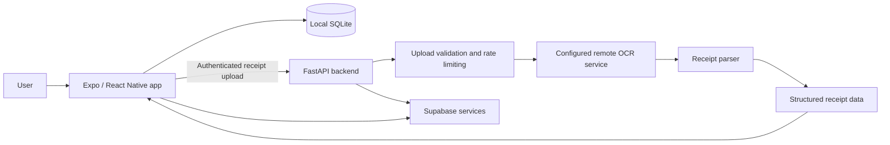

# FAIR — Fair And Intelligent Reconciliation

FAIR is a mobile expense-sharing app that helps groups split bills more
accurately. It combines receipt scanning, item-level assignment, expense
calculation, and debt settlement, with local SQLite storage for core
expense data.

The project includes a static website that introduces FAIR, documents 
its features, and provides access to its policies and project information.

Receipt scanning requires an internet connection because receipt images
are processed by a remote backend. If scanning fails or is unavailable,
users can enter items manually.

**Website:** [FAIR — Fair And Intelligent Reconciliation](https://fair-app.getfair.workers.dev/)

## Features

-   **Receipt scanning:** Upload receipt images for OCR and structured
    item extraction.
-   **Receipt parsing:** Extract item names, quantities, prices, and
    receipt totals using OCR output and rule-based parsing.
-   **Manual fallback:** Enter items manually when receipt scanning is
    unavailable or does not produce usable results.
-   **Item-level assignment:** Assign individual items to group members.
-   **Expense splitting:** Calculate individual shares from assigned
    items.
-   **Debt reconciliation:** Calculate balances and record settlements
    between group members.
-   **Local persistence:** Store core expense and group data in SQLite
    on the device.
-   **Authentication and remote services:** Use Supabase for the
    authentication and remote functionality implemented by the app.

## Architecture

FAIR has three main components:

1.  **Mobile app** --- React Native, Expo, and TypeScript provide the
    user interface, expense workflows, and local persistence.
2.  **FastAPI backend** --- Receives receipt images, validates uploads,
    invokes OCR, parses the result, and returns structured receipt data.
3.  **External services** --- The backend uses a configured remote
    Gradio OCR service. Supabase is used for authentication and the
    remote integrations implemented in the project.
4.  **Static website** — A website built with HTML, CSS, and JavaScript that introduces FAIR, explains its features, and provides access to project documentation, the Privacy Policy, and Terms and Conditions.



Receipt scanning depends on network access and the availability of the
backend and configured OCR service. Core expense workflows use local
data; exact offline behavior can still depend on the individual screen
or operation.

## Technology Stack

| Area | Technologies |
|------|--------------|
| Mobile app | React Native, Expo, Expo Router, TypeScript |
| Local storage | SQLite through `expo-sqlite` |
| Authentication | remote integration Supabase |
| Backend API | Python, FastAPI, Uvicorn |
| Receipt processing | OCR through a configured remote Gradio service; rule-based parsing |
| Backend utilities | Pillow, `python-dotenv`, `slowapi`, `gradio_client` |
| Static website | HTML, CSS, JavaScript |
| Website hosting | Cloudflare Pages |

The repository also contains a local PaddleOCR helper. Its dependencies
and runtime requirements may differ from the default remote OCR path.

## Project Structure

```text
Fair-App/
├── backend/
│   ├── app/
│   │   ├── api/              # Upload and health routes
│   │   ├── auth/             # Bearer-token authentication
│   │   ├── limiter/          # Request throttling
│   │   ├── services/         # OCR and receipt parsing
│   │   ├── database.py       # Supabase client setup
│   │   └── main.py           # FastAPI app and middleware
│   ├── .env-example
│   ├── .python-version
│   └── requirements.txt
│
├── frontend/
│   ├── app/                  # App screens and navigation
│   ├── components/           # Reusable UI components
│   ├── hooks/                # Custom hooks
│   ├── src/db/               # SQLite setup and schema
│   ├── src/services/         # Data-access services
│   ├── utils/                # Expense and splitting logic
│   ├── .env-example
│   ├── app.json
│   └── package.json
│
├── website/
│   ├── index.html            # Website landing page
│   ├── styles.css            # Website styles
│   ├── script.js             # Website interactions, if applicable
│   ├── assets/               # Logos, icons, screenshots, and images
│   ├── privacy.html          # Privacy Policy, if maintained separately
│   └── terms.html            # Terms and Conditions, if maintained separately
│
├── README.md
└── .gitignore
```

## Prerequisites

-   Git
-   Python 3.12
-   Node.js and npm
-   Expo-compatible development environment or device

## Setup

Clone the repository:

``` bash
git clone https://github.com/SudhanvaSM/Fair-App.git
cd Fair-App
```

### 1. Configure the backend

Create the backend environment file using `backend/.env-example` as a
reference. Set the required values for the services you intend to use.

The backend configuration uses these variables:

| Variable | Purpose |
|------|--------------|
| `SUPABASE_URL` | Supabase project URL |
| `SUPABASE_PUBLISHABLE_KEY` | Supabase publishable key used by the backend client |
| `OCR_SERVICE_URL` | Remote OCR service endpoint |
| `HF_TOKEN` | Token used to access the configured remote OCR service, if required |
| `CORS_ORIGINS` | Optional comma-separated allowed origins |
| `ENV` | Environment mode used for API documentation visibility |

Install dependencies and start the API:

``` bash
cd backend
python -m venv .venv
```

Activate the virtual environment, then run:

``` bash
python -m pip install -r requirements.txt
uvicorn app.main:app --reload --host 127.0.0.1 --port 8000
```

The remote OCR flow requires valid service configuration. Keep
server-side tokens such as `HF_TOKEN` private and out of source control.

### 2. Configure the frontend

Create the frontend environment file using `frontend/.env-example` as a
reference. The example file documents these variables:

| Variable | Purpose |
|------|--------------|
| `EXPO_PUBLIC_SUPABASE_URL` | Supabase project URL for the mobile app |
| `EXPO_PUBLIC_SUPABASE_PUBLISHABLE_KEY` | Supabase publishable key for client-side use |
| `EXPO_PUBLIC_API_URL` | Base URL of the receipt-processing API |

Install dependencies and start Expo:

``` bash
cd frontend
npm install
npx expo start
```

For a physical device, configure `EXPO_PUBLIC_API_URL` with a backend
address the device can reach. `localhost` on a phone refers to the phone
itself, not your development computer.

Only put client-safe values in `EXPO_PUBLIC_*` variables. Never place
service-role keys, private API tokens, or other server-side secrets in
the mobile app.

**Note:** Adjust the website filenames to match your actual files. For example, if your privacy policy and terms are sections within `index.html`, don't list separate HTML files that don't exist.

### 3. Website Deployment

FAIR's static website is hosted on Cloudflare Pages.

To deploy the website:

1. Connect the GitHub repository to Cloudflare Pages.
2. Configure the website directory as the deployment root, using the repository's `website` directory.
3. For a plain HTML, CSS, and JavaScript website, leave the build command empty if no build process is required.
4. Configure the output directory according to the Cloudflare Pages project settings and repository layout.
5. Deploy the site and verify that the landing page, assets, Privacy Policy, and Terms and Conditions load correctly.

The website is deployed independently of the FastAPI backend hosted on Render.

If the website links to the receipt-processing API, configure the appropriate backend URL. Do not expose private backend credentials in client-side website code.

## API

### `POST /upload`

Uploads a receipt image for processing. The route requires a valid
bearer token and accepts multipart form data.

Example for a locally running backend:

``` bash
curl -X POST "http://127.0.0.1:8000/upload" \
  -H "Authorization: Bearer <access-token>" \
  -F "file=@receipt.jpg"
```

Supported image formats and upload limits are enforced by the backend.
The upload route currently applies an 8 MB file-size limit; additional
request-size checks may reject larger requests.

### `GET /health`

Checks whether the API is responding:

``` bash
curl http://127.0.0.1:8000/health
```

Expected response:

``` json
{"status":"ok"}
```

## Data Handling and Privacy

-   Core expense and group data is stored locally using SQLite in the
    mobile app.
-   Receipt images are sent from the app to the FastAPI backend for
    processing.
-   The backend temporarily writes receipt images before sending them to
    the configured remote OCR service.
-   The backend uses Supabase-related configuration and validates bearer
    tokens for protected upload operations.
-   The remote OCR provider's own processing and retention practices are
    governed by that provider and should be reviewed separately.

Presence of local storage does not mean every feature works offline:
receipt scanning requires connectivity to the backend and OCR service.
Consult the published Privacy Policy for the app's complete
data-handling disclosures once it is available.

## Security Notes

The repository implements several protections for receipt processing,
including upload validation, request throttling, and bearer-token
authentication. These measures do not by themselves establish that the
application is free of vulnerabilities or has passed a formal security
audit.

When deploying:

-   Keep backend secrets in the hosting provider's environment
    configuration.
-   Do not commit `.env` files or credentials.
-   Configure the allowed CORS origins for the deployment.
-   Review the OCR provider's data-handling terms before sending real
    receipts.
-   Keep dependencies updated and test authentication, upload
    validation, and account/data deletion flows.

## Testing and Development

Backend tests are located under `backend/app/tests/`. Run the test suite
from the `backend` directory when the project's test dependencies are
installed:

``` bash
pytest
```

If the frontend defines a lint script in `frontend/package.json`, run it
from the `frontend` directory:

``` bash
npm run lint
```

## Contributing

Contributions and bug reports are welcome.

1.  Fork the repository.
2.  Create a branch for your change.
3.  Keep changes focused and explain the reason for them.
4.  Run relevant backend tests and frontend checks.
5.  Open a pull request describing the change and any testing performed.

## License

**`MIT`** License

------------------------------------------------------------------------

FAIR combines local expense management with remote receipt processing to
make group bill splitting easier. Contributions, bug reports, and
feedback are welcome.
