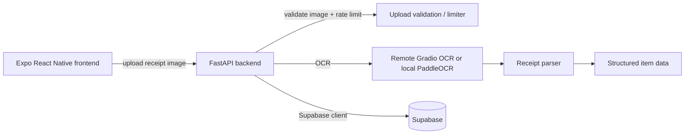

# FAIR — Fair And Intelligent Reconciliation

FAIR is a mobile-first expense-sharing application designed to simplify bill splitting by turning receipt images into structured data, estimating item-level contributions, and helping groups reconcile what each person owes.

---

## Overview

Splitting bills among friends or a group is often slow, inconsistent, and prone to error. FAIR addresses this by combining image-based receipt processing and structured parsing so users can review extracted items and calculate each member's share more consistently.

The repository implements a FastAPI backend that accepts receipt images, validates them, runs OCR, parses itemized data, and returns structured results to a client application. The frontend is built with Expo and React Native, which is the mobile application layer for user interaction.

This repository includes the core backend processing pipeline and the mobile app shell. The exact client-side sharing, assignment, and debt-tracking flows should be confirmed by reviewing the frontend source files in `frontend/app` and `frontend/src`.

---

## Key Features

Implemented and verified in the codebase:
- Receipt image upload through a FastAPI endpoint.
- Image validation for file size, supported formats, and dimensions.
- OCR pipeline using a remote Gradio service (`ocr_remote.py`) and a local PaddleOCR helper (`ocr_paddleocr.py`).
- Receipt parsing logic that extracts item names, quantities, unit prices, total prices, and receipt totals (`parser.py`).
- Rate limiting and upload-throttling safeguards.
- Supabase client initialization for backend-side integration.
- Bearer-token authentication using Supabase claims.
- Expo / React Native frontend scaffold.

Documented but not fully verified in code:
- Local SQLite-based persistence for the mobile client.
- Group creation, item assignment, and debt settlement UIs.
- Offline-first sync and final reconciliation workflows.

These areas are suggested by the app stack and project README, but their exact implementation should be confirmed from the frontend source before being described as complete features.

---

## How It Works

1. A user captures or selects a receipt image in the mobile app.
2. The app sends the image to the backend `POST /upload` endpoint.
3. The backend validates the file:
   - supported image types: JPEG, PNG, and WebP
   - size limit: 8 MB in the upload route
   - additional content-length guard in the app middleware
4. The backend calls OCR on the image.
   - The repo contains a remote OCR implementation in `backend/app/services/ocr_remote.py`.
   - A local PaddleOCR helper is also present in `backend/app/services/ocr_paddleocr.py`.
5. OCR output is passed into `parse_receipt` in `backend/app/services/parser.py`.
6. The parser converts receipt text into structured item rows with totals and confidence metadata.
7. The parsed result is returned to the client for review and downstream processing.

The repository does not show a complete end-to-end settlement UI in the files inspected, so the exact final user workflow should be confirmed from the frontend implementation.

---

## Technical Architecture

The project has a split architecture:
- Frontend: Expo / React Native mobile app.
- Backend: FastAPI application with OCR + parsing services.
- External services: Supabase + remote Gradio OCR service.



Responsibilities:
- Frontend: UI, image capture, client-side configuration, and app flows.
- Backend: validation, OCR, parsing, authentication, rate limiting, and server-side integration.
- Supabase: session/auth and cloud-side integration points defined in backend configuration.

---

## Technology Stack

Frontend
- Expo
- React Native
- TypeScript
- expo-image-picker
- expo-sqlite
- @supabase/supabase-js

Backend
- Python 3.12
- FastAPI
- uvicorn
- Pillow
- supabase
- python-dotenv
- slowapi
- gradio_client

Implementation notes:
- `backend/.python-version` pins Python 3.12.
- `frontend/package.json` confirms Expo and React Native usage.
- `backend/requirements.txt` confirms the backend dependency set.
- The local PaddleOCR helper exists, but its additional native dependencies are not explicitly listed as required in the backend requirements file.

---

## Installation and Setup

### Prerequisites
- Python 3.12
- Node.js and npm
- Git

### Backend

```bash
cd backend
python -m pip install -r requirements.txt
uvicorn app.main:app --reload --host 0.0.0.0 --port 8000
```

### Frontend

```bash
cd frontend
npm install
npm start
# or
npx expo start
```

---

## Environment Variables

The following environment variables are verified in the codebase.

### Backend
- `SUPABASE_URL` — required by `backend/app/database.py`.
- `SUPABASE_PUBLISHABLE_KEY` — required by `backend/app/database.py`.
- `OCR_SERVICE_URL` — required by `backend/app/services/ocr_remote.py` if using remote OCR.
- `HF_TOKEN` — required by `backend/app/services/ocr_remote.py` if using remote OCR.
- `CORS_ORIGINS` — optional comma-separated origins used by FastAPI CORS middleware.
- `ENV` — used in `backend/app/api/routes.py` to toggle OpenAPI/docs visibility in production mode.

### Frontend
The frontend includes an example file at `frontend/.env-example`:
- `EXPO_PUBLIC_SUPABASE_URL`
- `EXPO_PUBLIC_SUPABASE_PUBLISHABLE_KEY`
- `EXPO_PUBLIC_API_URL`

Keep secrets out of the repository. Only use public client-safe values for `EXPO_PUBLIC_*` variables.

---

## Usage

### Backend endpoint
The core API endpoint is:

```bash
curl -X POST "http://localhost:8000/upload" \
  -H "Authorization: Bearer <token>" \
  -F "file=@receipt.jpg"
```

This route validates the file and returns parsed receipt JSON with structured fields including item rows and totals.

### Health check
```bash
curl http://localhost:8000/health
```

Expected response:
```json
{"status":"ok"}
```

Authentication is enforced by the backend (`backend/app/auth/authentication.py`). The app verifies a bearer token with Supabase claims and expects an authenticated, non-anonymous user.

---

## Project Structure

```text
Fair-App/
├── backend/
│   ├── app/
│   │   ├── api/
│   │   │   └── routes.py         # upload endpoint and health route
│   │   ├── auth/
│   │   │   └── authentication.py # Bearer token validation with Supabase
│   │   ├── limiter/
│   │   │   └── limiter logic     # request throttling
│   │   ├── services/
│   │   │   ├── ocr_remote.py     # remote Gradio OCR client
│   │   │   ├── ocr_paddleocr.py  # local PaddleOCR helper
│   │   │   ├── parser.py         # item extraction and total parsing
│   │   │   └── replace_service.py
│   │   ├── database.py           # Supabase client creation
│   │   ├── main.py               # FastAPI app setup and middlewares
│   │   └── tests/
│   ├── .env-example
│   ├── .python-version
│   ├── requirements.txt
│   └── uploads/
├── frontend/
│   ├── app/
│   ├── src/
│   ├── .env-example
│   ├── app.json
│   ├── package.json
│   ├── tsconfig.json
│   └── package-lock.json
├── Readme.md
├── .gitignore
└── LICENSE (not present)
```

---

## Data Storage and Privacy

Verified details from the repository:
- The backend creates an `uploads/` directory at runtime.
- Images are written to a temporary file in `ocr_remote.py` before being sent to a remote OCR service.
- `ocr_remote.py` sends the file to a Gradio endpoint using a token and URL from environment variables.
- The frontend includes `expo-sqlite`, which indicates local database usage in the mobile application, but the exact schema and data retention behavior should be confirmed by reviewing the frontend source.
- Supabase is initialized in the backend client, but the exact persistence patterns for user or receipt records must be confirmed in the frontend/backend application code.

Do not make privacy or retention guarantees beyond what is visible in the repository. If the application handles sensitive images, confirm the remote OCR service’s data handling policy before deployment.

---

## Security

The repository shows the following security-relevant practices:
- Environment variables are used instead of hard-coded secrets.
- Upload-size and image-dimension validation are enforced.
- The upload route uses rate limiting.
- Bearer-token authentication is enforced before processing uploads.

The project does not show evidence of a completed security audit or formal compliance review. Treat deployment as requiring normal production hardening and environment management.

---

## Limitations

The code establishes the following constraints:
- Upload size is limited to roughly 8 MB in `backend/app/api/routes.py`.
- The backend also checks content length and rejects payloads above about 9 MB in `backend/app/main.py`.
- OCR depends on external configuration: remote OCR requires `OCR_SERVICE_URL` and `HF_TOKEN`.
- The exact frontend workflow for item assignment and settlement is not fully visible from the backend alone.
- The repository does not include a `LICENSE` file.

---

## Roadmap

The project README documents planned improvements, including:
- Pairwise debt simplification
- ML-based receipt parsing
- Authentication and user accounts
- Cloud storage and database integration
- Payment integration

These are project goals and should be treated as planned directions rather than confirmed implemented functionality.

---

## Contributing

Contributions are welcome via pull requests.

Suggested workflow:
1. Fork the repository.
2. Create a feature branch.
3. Validate the backend with `pytest` where applicable.
4. Run frontend linting with `npm run lint`.
5. Open a pull request with a clear summary of the change.

Example commands:

```bash
cd backend
pytest
```

```bash
cd frontend
npm run lint
```

---

## License

No `LICENSE` file was found in the repository root. The project currently does not specify an open-source license.

---

## Acknowledgements

- FastAPI
- Expo / React Native
- Supabase
- Pillow
- slowapi
- Gradio Client

---

## Summary

FAIR is a practical, receipt-driven expense-splitting project with a verified backend OCR pipeline and a React Native frontend app. Its strongest implemented functionality is image upload, OCR interpretation, and structured receipt parsing. Additional app features such as group management, assignment logic, and final settlement workflows should be reviewed in the frontend source before being treated as fully delivered.
